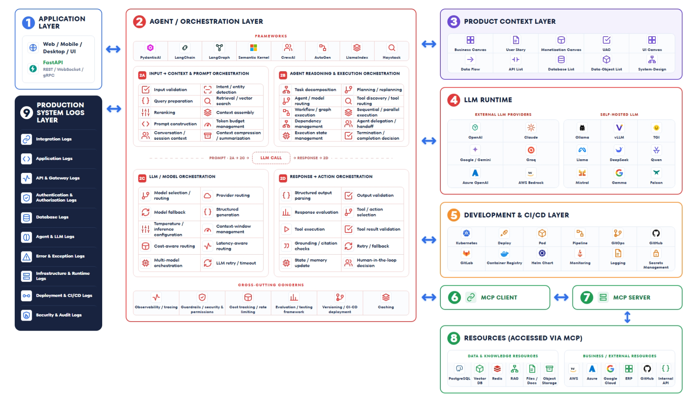

# Submission Notes — Mini RAG Chatbot Backend

## Document structure

This document covers everything requested in `README.md`'s submission checklist: how to run
ingestion and the server, how to test the WebSocket protocol, and the design decisions behind
chunking, RBAC, and the parallel tool call. Each numbered section below is self-contained and
can be read independently; the checkmarks indicate every section is complete and verified
against the running code (see `mds/TEST_SCENARIOS.md` for the underlying test evidence).

1. ✅ [File structure](#1--file-structure)
2. ✅ [How to run the ingestion script](#2--how-to-run-the-ingestion-script)
3. ✅ [How to run the server](#3--how-to-run-the-server)
4. ✅ [How to test](#4--how-to-test)
5. ✅ [Chunking strategy](#5--chunking-strategy)
6. ✅ [RBAC approach](#6--rbac-approach)
7. ✅ [Async/parallel approach](#7--asyncparallel-approach)
8. ✅ [LLM and embedding provider](#8--llm-and-embedding-provider)
9. ✅ [Things I would improve given more time](#9--things-i-would-improve-given-more-time)
10. ✅ [One tradeoff I made and why](#10--one-tradeoff-i-made-and-why)
11. ✅ [Component-relation diagram](#11--component-relation-diagram)

======================================================================

## 1. ✅ File structure

The tree below is the full `app/` package plus the supporting files referenced elsewhere in
this document, so every claim made later (a file path, a function name) can be checked
directly against the layout. It follows the feature-package structure documented in
`mds/A2. CODEBASE_STRUCTURE_PYTHON.md` — one `feature_<name>/` per business capability, with
concrete providers isolated behind `Protocol` interfaces.

```
app/
  main.py                          FastAPI app, includes routers only — no logic
  core/
    config.py                      Settings (.env), read once via get_settings()
    dependencies.py                Provider singletons: get_embedder / get_vectorstore / get_llm_provider

  features/
    feature_auth/
      schemas/auth_schemas.py      TokenPayload (verified JWT claims)
      services/service_verify_jwt.py

    feature_chat/
      router.py                    Thin door: declares /ws/chat, injects providers
      handlers/handle_chat_socket.py   Owns the WS lifecycle: auth -> message loop
      services/
        service_retrieve_chunks.py     Embed + RBAC-filtered Chroma query
        service_stream_llm.py          Builds context/system prompt, streams the LLM
      schemas/chat_schemas.py      Pydantic models for the wire protocol

    feature_employee_tool/
      tool_get_employee_context.py     asyncio.gather over the 3 mocks; user-bound closure
      services/
        service_get_profile.py
        service_get_manager.py
        service_get_team.py

    feature_ingest/
      cli.py                       Entry point: python -m app.features.feature_ingest.cli
      configs/access_map.py        File -> department/access_level mapping
      services/
        service_extract_pdf.py         pypdf text extraction
        service_ocr_pdf.py             PyMuPDF render + EasyOCR fallback
        service_chunk_text.py          Word-based chunking with overlap

  providers/
    embeddings/
      base.py                      EmbeddingProvider Protocol
      sentence_transformers_provider.py
    llm/
      base.py                      LLMProvider Protocol
      gemini_provider.py           Default — automatic function calling
      openai_provider.py           Swappable alternative — manual tool-call loop
    vectorstore/
      base.py                      VectorStore Protocol, Chunk model
      chroma_store.py              RBAC where-filter query lives here

mds/
  A2. CODEBASE_STRUCTURE_PYTHON.md         Architecture standard followed throughout
  TEST_SCENARIOS.md                        Manual RBAC/tool/provider test log
  PROPOSED_IMPROVED_VERSION.png            Reference diagram for section 9
  mini_rag_chatbot_diagram.json            Source for section 11's diagram
  Mini RAG Chatbot - Component-Relation-Diagram.jpg

docs/                              Given source PDFs (untouched)
mint_tokens.py / test_client.html  Given test tooling (untouched)
requirements.txt / .env.example
```

Code organization follows the standard documented in
[`mds/A2. CODEBASE_STRUCTURE_PYTHON.md`](mds/A2.%20CODEBASE_STRUCTURE_PYTHON.md), written
before implementation and used as the reference throughout.

======================================================================

## 2. ✅ How to run the ingestion script

This has to be run once (or whenever `docs/` changes) before the chat server can answer
anything — it turns the seven sample PDFs into the Chroma collection the retrieval step
queries at request time. It also builds the local Python environment the server itself runs
in.


```bash
python -m venv venv
venv\Scripts\activate            # Windows; use `source venv/bin/activate` on macOS/Linux
pip install -r requirements.txt

cp .env.example .env
# Edit .env: set JWT_SECRET, GEMINI_API_KEY (or OPENAI_API_KEY + LLM_PROVIDER=openai)

python -m app.features.feature_ingest.cli
```

**Note:** `openai` is listed in `requirements.txt` even though Gemini is the default provider —
`app/core/dependencies.py` imports `OpenAIProvider` unconditionally so the two providers can
share one `lru_cache`d factory function, which means the import has to succeed regardless of
`LLM_PROVIDER`. This was caught during review (the package was present in the dev venv but
missing from the manifest, so a fresh `pip install -r requirements.txt` would have failed at
startup even with `LLM_PROVIDER=gemini`) and is now fixed.

This walks `docs/*/*.pdf`, extracts text per page with `pypdf`, and automatically falls back
to OCR (PyMuPDF render + EasyOCR) for any page that comes back empty — no manual flag needed
to mark `exec/strategic_plan.pdf` as scanned. Each page's text is chunked, embedded with
`sentence-transformers`, and upserted into a local/persistent Chroma collection at
`./chroma_data`. The first run downloads the embedding model (~130MB) and EasyOCR's detection
model (~50MB); both are cached afterward.

======================================================================

## 3. ✅ How to run the server

Starting the server is a single command once the ingestion step above has populated Chroma
and `.env` has a valid `JWT_SECRET` and LLM key. `--reload` is used for development so code
edits take effect without a manual restart.

```bash
uvicorn app.main:app --reload
```

Serves `ws://localhost:8000/ws/chat`. Run the ingestion script first — the chat endpoint
queries the Chroma collection it produces.

======================================================================

## 4. ✅ How to test

The provided `test_client.html` speaks the exact protocol `README.md` specifies, so testing
end to end doesn't require writing a custom client. The steps below get from zero to a
streamed, RBAC-filtered answer in a browser.

1. `python mint_tokens.py` — prints one JWT per test user (`emp-001`/hr/1, `mgr-002`/hr/2,
   `exec-003`/exec/3).
2. Open `test_client.html` directly in a browser (double-click, no build step).
3. Paste a token, click **Connect**. Expected exchange:
   ```json
   → {"type": "auth", "token": "<jwt>"}
   ← {"type": "auth_success", "user_id": "exec-003", "department": "exec", "level": 3}
   → {"type": "message", "text": "what is the strategic plan for 2026?"}
   ← {"type": "stream", "text": "The strategic plan..."}
   ← {"type": "stream", "text": " for 2026-2028..."}
   ← {"type": "done"}
   ```
4. A full manual test matrix (RBAC boundaries per role, the OCR document, the parallel
   tool call, and a provider swap to OpenAI) is recorded in `mds/TEST_SCENARIOS.md`, with
   every scenario passing against the submitted code.

**Malformed-input handling:** `handle_chat_socket.py` now wraps both the initial auth
receive/parse and each message receive/parse in the loop in their own `try/except`
(`app/features/feature_chat/handlers/handle_chat_socket.py`). Previously, a structurally
invalid payload (e.g. `{}`, a wrong field type, or non-object JSON) raised an uncaught
Pydantic `ValidationError` inside `receive_json()`/`IncomingMessage(**raw)`, which crashed
the handler before an `auth_failed` (pre-auth) or `error` (post-auth) event could be sent —
found during review and fixed. Behavior now: a malformed auth payload gets `auth_failed` and
the socket closes; a malformed in-loop message gets an `error` event and the connection stays
open, matching the same "never crash the connection" rule already applied to
retrieval/LLM failures.

======================================================================

## 5. ✅ Chunking strategy

Every extracted page is split into overlapping chunks before embedding, so retrieval can
return a focused passage instead of an entire page. The approach here is deliberately simple
— word-count-based, not a magic number copied from a tutorial — and is explained below.

Word-count-based chunking, **300 words per chunk with a 50-word overlap**, applied per PDF
page (`app/features/feature_ingest/services/service_chunk_text.py`).

- **Why word count, not a tokenizer:** word count tracks token count closely enough for
  English policy prose to size chunks sensibly, without adding a tokenizer dependency
  (e.g. `tiktoken`) purely for chunk sizing.
- **Why 300/50:** 300 words keeps a chunk focused on one or two related clauses of a policy
  document (short enough for precise retrieval, long enough to stay coherent on its own).
  The 50-word overlap prevents a sentence or a numbered clause from being split exactly at a
  chunk boundary and losing its context in either half.
- **Why per-page:** chunking within page boundaries keeps the `page` metadata field accurate
  per README's requirement, rather than chunking across the whole document and having to
  back-compute which page a chunk's midpoint fell on.
- In practice, the seven sample PDFs are short enough that most produced exactly one chunk
  each — the strategy is sized for realistic multi-page policy documents, not tuned to these
  particular short samples.

======================================================================

## 6. ✅ RBAC approach

Access control is enforced where the data is retrieved, not as an afterthought layered on top
of it. Every chunk carries its own RBAC metadata at ingestion time, and every query narrows
the search space to only what the requesting user is allowed to see before ranking begins.

Metadata stored on every chunk: `department`, `access_level`, `source_file`, `page`
(`app/features/feature_ingest/configs/access_map.py` maps each source file to its
department/level per the table in `README.md`).

Filtering happens **inside the vector store query**, not as a Python post-filter
(`app/providers/vectorstore/chroma_store.py::ChromaStore.query`):

```python
where_filter = {
    "$and": [
        {"$or": [{"department": department}, {"department": "hr"}]},
        {"access_level": {"$lte": level}},
    ]
}
```

This expresses `department == user.department OR department == "hr"`, both capped by
`access_level <= user.level`, as a single Chroma `where` clause.

**Why at the DB layer, not after retrieval:** Chroma's similarity search only ranks the
top-`k` results *within the filtered set*. If filtering happened in Python after retrieval,
the initial top-`k` could be dominated by documents the user isn't allowed to see, leaving
fewer (or zero) permitted results even when relevant permitted documents exist elsewhere in
the collection. Filtering at the DB layer also means an authorization bug can never leak
document content through search ranking — the disallowed documents are never fetched in the
first place. This was verified manually: an `exec` user's finance-related query never
returns `expense_policy.pdf`, even though it's the most topically relevant document, because
it's excluded from the candidate set before Chroma even computes similarity (see
`mds/TEST_SCENARIOS.md`, Scenario 4).

======================================================================

## 7. ✅ Async/parallel approach

The assignment's parallel-tool-call requirement is satisfied by one specific piece of code:
the three mocked employee-data lookups run concurrently instead of one after another. The
rest of this section covers that mechanism plus the general rule the codebase follows for
never blocking the event loop.

The `get_employee_context` tool (`app/features/feature_employee_tool/tool_get_employee_context.py`)
runs its three mocked lookups concurrently:

```python
profile, manager, team = await asyncio.gather(
    service_get_profile(user_id),
    service_get_manager(user_id),
    service_get_team(user_id),
)
```

Each mock sleeps 1s; run sequentially this would take ~3s, but `asyncio.gather` starts all
three coroutines together, so the total wall time is bounded by the slowest single call.
Measured in isolation: **1.01s** (see `mds/TEST_SCENARIOS.md`).

The tool is exposed to the LLM as a zero-argument closure bound to the authenticated user's
`sub` claim (`make_employee_context_tool(user_id)`) — the model is never given `user_id` as a
parameter to fill in itself, so it can only ever fetch the current connection's own data,
preserving the RBAC identity boundary established at auth time.

Separately, the embedding model and Chroma's client are both synchronous/CPU-bound; calling
them directly inside an `async def` handler would block the event loop for every other
connection. Both are wrapped in `asyncio.to_thread` in
`app/features/feature_chat/services/service_retrieve_chunks.py` so retrieval never blocks
concurrent WebSocket connections.

======================================================================

## 8. ✅ LLM and embedding provider

Three concerns are covered here: which concrete LLM/embedding/vector-store were chosen and
why, and how the LLM specifically was kept swappable so the choice isn't locked in. Both
Gemini and OpenAI were tested working end to end, not just wired up on paper.

**Embeddings:** `sentence-transformers` with `BAAI/bge-small-en-v1.5` — free, runs on CPU,
downloads once (~130MB).

**Vector store:** Chroma, local/persistent mode (`./chroma_data`) — no Docker required.

**LLM:** Google Gemini (`gemini-2.5-flash`), free tier, no billing needed. Chosen for
built-in automatic function calling (needed for the employee-context tool) and generous
enough free-tier limits for development. Note: the `-lite` tier of the same model family was
tried first and was less reliable at tool-call judgment (it occasionally invented nonexistent
tool names when document names appeared in context); the full `flash` tier fixed this — see
`mds/TEST_SCENARIOS.md`, "Known issues."

**Pluggability:** all three are accessed through `Protocol` interfaces
(`app/providers/llm/base.py`, `app/providers/embeddings/base.py`,
`app/providers/vectorstore/base.py`); no feature code imports a concrete provider class
directly. A second LLM provider, `app/providers/llm/openai_provider.py` (OpenAI, manual
tool-call loop since OpenAI's SDK has no automatic-function-calling equivalent), is included
and was tested working end-to-end — both the RAG question and the tool-call question produced
correct answers. Switching providers is a single `.env` line:

```env
LLM_PROVIDER=gemini   # or: openai
```

with no code changes required in `feature_chat`.

======================================================================

## 9. ✅ Things I would improve given more time    

This assignment is deliberately scoped small (a single WebSocket endpoint, one tool, one
retrieval path). Below is where I'd take it if it needed to grow into a production system,
mapped against a general agent-architecture reference I use for larger builds:



**1 — Application Layer.** Already covers the assignment's needs (FastAPI over WebSocket,
`test_client.html` as a minimal UI). No change needed at this scale; a real product would add
a proper web/mobile client and possibly gRPC for internal service-to-service calls.

**2 — Agent/Orchestration Layer.** This is where the current build is thinnest relative to
the diagram. Today, "orchestration" is one hand-written function
(`service_stream_llm` + `handle_chat_socket`) doing input handling, retrieval, prompt
construction, and tool dispatch inline. The diagram's 2A–2D breakdown names what that
function silently does today and what it's missing:
- *2A (input → prompt):* we do query prep and retrieval, but no reranking, no conversation
  context (see the memory point below), and no token-budget management — a long chunk list
  could overflow the context window with no guard today.
- *2B/2C (agent reasoning, model orchestration):* single-model, single-provider per request,
  no fallback if Gemini/OpenAI errors (a 429 is surfaced to the user, not retried or routed
  to a backup provider), no cost- or latency-aware routing.
- *2D (response → action):* no output validation beyond "did the stream produce any text,"
  no grounding/citation check beyond asking the model nicely in the prompt to cite sources.
- *Cross-cutting:* no tracing/observability, no rate-limiting beyond what the provider
  enforces, no evaluation harness to catch regressions in retrieval or answer quality.

A framework (LangGraph or PydanticAI, per the diagram) would formalize this instead of the
current linear function, and give retries, fallback routing, and tracing largely for free.

**3 — Product Context Layer.** Out of scope for a backend take-home — this is
product/business-side artifacts (user stories, monetization canvas), not something a 4-6
hour backend assignment produces.

**4 — LLM Runtime.** Partially done: two external providers (Gemini, OpenAI) already sit
behind the same `LLMProvider` interface and are swappable via `.env` (see section 7). A
self-hosted option (Ollama, per the assignment's own suggestion) would be the natural next
provider to add, useful for offline dev and avoiding rate limits during testing.

**6/7 — MCP client/server.** Currently `get_employee_context` is an in-process Python
function the LLM calls directly. Exposing it (and the RAG retrieval path) as an MCP server
would let *any* MCP-compatible client reuse these capabilities without depending on this
FastAPI app's internals, and consuming external MCP servers as a client would let the bot
pull in resources (e.g. a real HR system, a ticketing system) without hand-writing a new
`feature_<name>` for each one. This is the highest-leverage structural change for making the
system "open" rather than a closed set of hardcoded tools.

**8 — Resources.** Today the only "resource" is Chroma. An MCP-fronted resource layer would
let the same agent reach a real Postgres HR database, Redis for session/conversation state,
and object storage for the source PDFs themselves, instead of everything living in one local
vector store.

**5/9 — Dev & CI/CD Layer, Production System Logs Layer.** Nothing here today beyond
`uvicorn --reload` and print statements. For production readiness this is actually the
first thing I'd add, not the last: structured logs per category (auth, LLM/agent calls, tool
calls, errors) feeding a real log pipeline, so that failures (like the Gemini 429s and the
tool-hallucination bug hit during testing — see `mds/TEST_SCENARIOS.md`) are caught by
monitoring and alerting instead of being noticed only because a human was watching the
WebSocket log at the time. Paired with CI (tests + linting on every push) and a deploy
pipeline, this closes the loop from "error happened" to "someone/something notices and fixes
it" automatically, rather than relying on manual testing the way this submission's
`mds/TEST_SCENARIOS.md` currently does.

**Conversation memory across turns.** Separately from the diagram: each
`{"type": "message", ...}` is currently handled independently — no rolling message history
is kept per connection, so a follow-up question loses the context of the previous exchange.
This is really part of 2A (context assembly / token budget management) above, but it's the
single most noticeable gap in a live demo, so it's worth calling out on its own.

======================================================================

## 10. ✅ One tradeoff I made and why

Every non-trivial technical choice trades something off; this is the one with the clearest
downside, named explicitly rather than left implicit. It's about the vector store, since that
decision shaped how the RBAC filter in section 6 had to be written.

**Chroma instead of the recommended Qdrant.** The development machine has no Docker
available, and Qdrant's local/embedded mode is less mature than Chroma's. Chroma's
`PersistentClient` runs fully in-process against a local directory with no server to manage,
which fit the environment better. The tradeoff: Qdrant's filter DSL (`Filter`/`FieldCondition`
with typed range/match conditions) is more expressive for complex nested RBAC rules than
Chroma's `$and`/`$or`/`$lte` dict-based `where` clause. For this assignment's two-level rule
(own department or hr, capped by access level) Chroma's filter syntax was sufficient and
equally enforceable at the DB layer, but a more elaborate RBAC model (e.g. per-document ACLs,
group-based access) would likely outgrow it before it would outgrow Qdrant.

======================================================================

## 11. ✅ Component-relation diagram

This is the actual, as-built request flow through the system — not the proposed future
architecture from section 9. It traces one WebSocket connection end to end: the client opens
the socket and authenticates, `handle_chat_socket.py` verifies the JWT once and then owns a
loop where every incoming message is embedded and matched against Chroma under the caller's
own RBAC filter before the result ever reaches an LLM. From there the retrieved chunks become
the model's context, the model either answers from that context directly or calls the
employee-context tool for a personal question, and the answer streams back to the client
token by token, with the connection staying open whether the turn ended in a normal answer or
a caught error.

The diagram deliberately mirrors the codebase's own module boundaries rather than compressing
them into a generic "backend does stuff" box — `Verify JWT`, `Retrieve Chunks`, `Stream LLM
Answer`, and `Employee Context Tool` are each a real file under `app/features/`, and `Chroma
Vector Store` / `LLM Provider` are each a real file under `app/providers/`. Reading it top to
bottom answers the same question the rubric asks of the code itself: where RBAC is enforced
(inside `Chroma Vector Store`, not after), and where the parallel tool call happens (inside
`Employee Context Tool`, isolated from the LLM round-trip around it). The machine-readable
source for this diagram is
[`mds/mini_rag_chatbot_diagram.json`](mds/mini_rag_chatbot_diagram.json).


